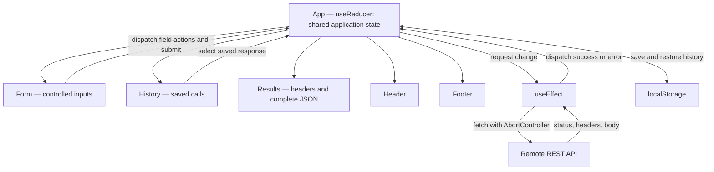

# RESTy — Code 401 Completed Demo

A working instructional REST API client covering **Component-Based UI**, **useState**, **useEffect**, and **useReducer**.

## Get started

```bash
git clone git@github.com:jtimm-gicw/resty.git
cd resty
git switch completed-demo
npm install
npm start
```

Visit http://localhost:3000. Run tests with `CI=true npm test -- --watchAll=false` and create a production build using `npm run build`.

**Important:** The existing repository was built with Create React App / `react-scripts`, so it runs with `npm start`. The *lab handout* specifies Vite, but this completed-demo branch deliberately preserves the original application's build environment. For a strict Vite submission, migrate separately and replace the CRA build scripts/entry point.

## Architecture / UML-style component diagram



## Four phases explained

| Phase | Code | What students should observe |
| --- | --- | --- |
| 1 — Components | `src/components/*` | Header, Form, Results and Footer are function components, each with its own SCSS; Form sends submitted input to App. The original `base` branch preserves class-based App + mock results. |
| 2 — State | `src/state/restyReducer.js`, `Form.js` | Controlled URL, method and JSON input, GET default, highlighted active method and loading status. The `real-api` branch shows interim useState. |
| 3 — Effect | `src/app.js`, `src/api/request.js` | Submitting updates request state; useEffect observes that change, sends real fetch requests, aborts outdated requests, and shows headers, status and full JSON. |
| 4 — Reducer | `src/state/restyReducer.js`, `History.js` | A reducer manages loading, responses and history; click an entry to restore its saved result. History also survives refresh through localStorage. |

## Demo with a public API

1. Select GET, enter `https://jsonplaceholder.typicode.com/users/1`, and click **GO!**.
2. Show HTTP status, response headers and color-coded JSON body.
3. Change the URL to `https://jsonplaceholder.typicode.com/posts/1`, then submit.
4. Click the old request in **Request History** and show that its saved JSON reappears.
5. Refresh and open a saved history entry. History uses localStorage.
6. For safe demonstrations of POST/PUT/PATCH/DELETE, use a local test API or mocked endpoint. Public REST APIs can refuse writes or have browser CORS restrictions.

## Tests

`src/__tests__/App.test.js` uses React Testing Library and MSW to test component rendering, GET response, headers, complete JSON/pagination, POST JSON parsing, validation, HTTP errors, history selection and localStorage restoration. `src/state/restyReducer.test.js` tests reducer transitions.

GitHub Actions runs tests and a build on pushes and pull requests. The tests mock API traffic, so they don't depend on the public internet.

## Notes and limitations

- Browser CORS policies may prevent requests to an API even if the URL is valid.
- History stores up to 50 responses, including error responses, in **this browser only**. Avoid storing credentials or sensitive data; no authentication token inputs are provided.
- Request body is supported for POST, PUT and PATCH. Non-JSON response bodies appear as text; 204 responses display null.
- App state is handled with `useReducer` in the finished build. The previous branches show the earlier scaffolding progression.

## Git hygiene

`node_modules` and `.env` are ignored in this branch; do not commit secrets. If real credentials were ever committed previously, rotate them and review repository history.

## AI assistance disclosure (Code 401 requirement)

An AI assistant reviewed the four-phase specification and implemented this completed-demo example at the instructor's request. The request was: “Using my jtimm-gicw/resty GitHub repository, create a new completed-demo branch and implement the missing requirements for RESTy phases 1–4. Preserve my original branches. Fix API requests, useEffect, useReducer, interactive history, response headers, and tests. Explain each change for students.”

Contribution: React component refactor, reducer and effect design, HTTP helper, history persistence, SCSS styling, MSW/React Testing Library tests, CI workflow and documentation. The instructor should review and execute the project before presenting it as verified.
