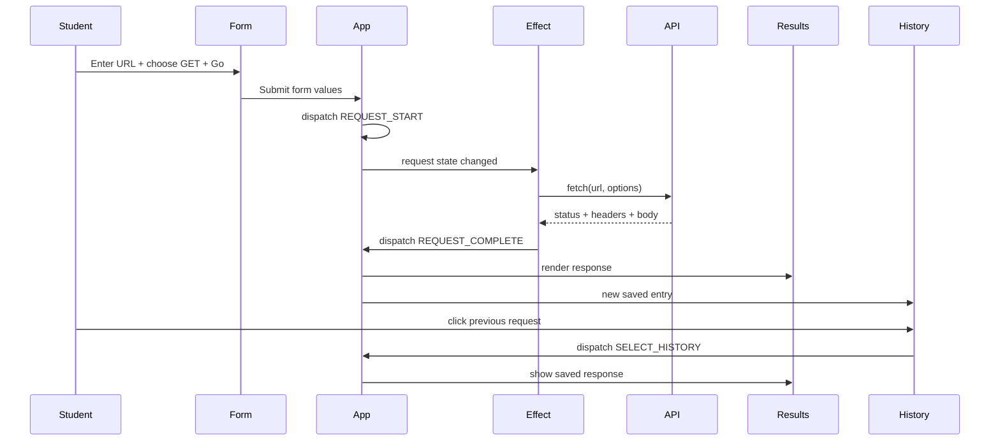

# RESTy — Completed Demo Instructor Walkthrough

## Prep (before class)
- Open branch `completed-demo`; run `npm install`, then `npm start`.
- In a separate terminal run `CI=true npm test -- --watchAll=false`.
- Keep `src/app.js`, `src/state/restyReducer.js`, `src/api/request.js`, and `src/components/Form/Form.js` open.
- Confirm the classroom network allows your chosen API. Tests use MSW and do not require external API access.

## UML / Data Flow

## 45-minute plan

### 0–8 min — Phase 1 components
**FILE TO OPEN:** `src/app.js`, `src/components/Form/Form.js`.
- Explain: a component is a reusable part of the page. App is the parent, Form/Results/History are children.
- Explain: props pass data or callbacks into children; children don't directly alter their parent.
- Compare the old `base` branch, where App is a class and data is mocked.
- Ask: “Which component reads user input? Which component displays the answer?”

### 8–17 min — Phase 2 state
**FILE TO OPEN:** `src/state/restyReducer.js`, `src/components/Form/Form.js`.
- Point out GET is the default method. Click POST and watch the request body textarea appear.
- Show that input's `value` comes from `state.draft`; `onChange` dispatches an action.
- The older `real-api` branch illustrates `useState`; this completed version consolidates shared state using `useReducer`.
- Ask: “Why can't an ordinary local variable remember typed input across renders?”

### 17–28 min — Phase 3 HTTP and effect
**FILE TO OPEN:** `src/app.js`, `src/api/request.js`.
- Enter `https://jsonplaceholder.typicode.com/users/1`, click GO.
- Trace: submit → REQUEST_START → new state.request → useEffect → sendRequest → REQUEST_COMPLETE.
- Show HTTP status, headers and complete JSON separately. An effect is used because HTTP requests communicate with an outside system.
- Explain `JSON.parse` validates text typed in the body and `JSON.stringify` encodes the actual object for POST/PUT/PATCH.
- Discuss error handling and CORS; a 404 is an HTTP response, not a successful status.

### 28–39 min — Phase 4 reducer and history
**FILE TO OPEN:** `src/state/restyReducer.js`, `src/components/History/History.js`.
- Show the reducer is a rulebook: state + action → next state.
- Make two GET calls, click first history entry, and show the saved response is restored.
- Refresh and click a saved entry. localStorage keeps history in the same browser.
- Explain why useReducer is better than multiple independent state setters once the app needs several coordinated updates.

### 39–45 min — Tests and review
**FILE TO OPEN:** `src/__tests__/App.test.js`.
- Explain MSW intercepts fetch and gives reliable pretend responses in tests.
- Run tests; show GET, POST, 404, validation and saved history assertions.
- Ask: “What would break if we saved only the URL but not the response?”

## Useful reminders
- `useState`: store a simple value (shown in earlier branches).
- `useEffect`: perform an external action when its dependencies change.
- `useReducer`: group related state changes as named actions.
- `localStorage`: browser storage, *not* React state; the effect synchronizes stored history with state.
- A failed CORS request is not a React bug. Use MSW or a CORS-enabled testing API when demonstrating.
