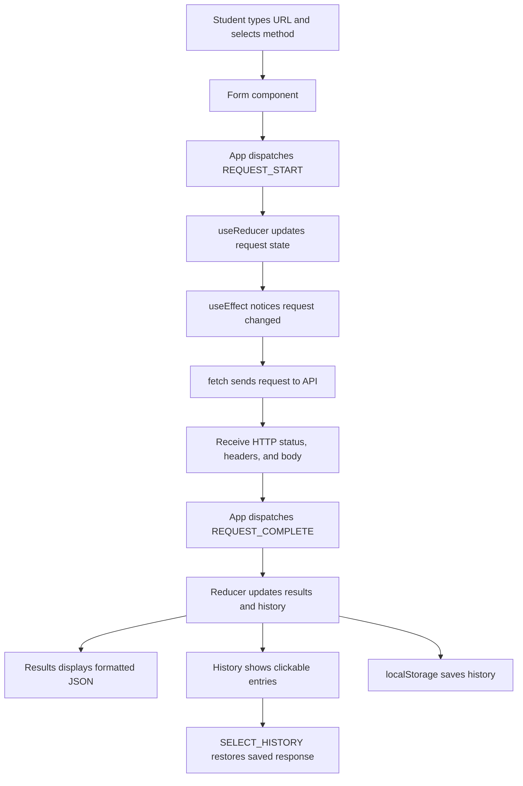

# 🧪 RESTy — TEST ME! (Live Classroom Demo)

> **Instructor Edition | Code 401 | Phases 1–4**  
> Branch: `completed-demo` | Estimated demo: **30–45 minutes**  
> Goal: Show students **what the RESTy application does**, then connect each action to **components, state, effects, and reducers**.

---

## 🎯 What students will learn

After this demonstration, students should be able to explain:

1. **Components:** Each React component has a job: Form collects information, Results displays the answer, History remembers previous requests.
2. **Controlled inputs:** The URL, selected method, and optional JSON body are held in React state.
3. **Props and callbacks:** Form submits a request to App; App supplies results to Results and History.
4. **`useEffect`:** When a submitted request changes, the app communicates with the outside API using `fetch()`.
5. **`useReducer`:** Actions such as `REQUEST_START`, `REQUEST_COMPLETE`, and `SELECT_HISTORY` manage related pieces of state together.
6. **`localStorage`:** History can still be available after refreshing the same browser.

## 🛠️ 0. Before class: launch RESTy

Open a terminal in your existing local `resty` repository.

```bash
git fetch origin
git switch completed-demo
git pull origin completed-demo
npm install
npm start
```

**Open:** http://localhost:3000

> ⚠️ This repository uses **Create React App**, not Vite. Run **`npm start`**, not `npm run dev`. The original lab handout specified Vite; this demo branch retains the existing CRA setup.

**Initial screen checklist:**

- [ ] RESTy header appears.
- [ ] The URL input is empty.
- [ ] **GET** is selected by default (visually highlighted).
- [ ] The GO! button is available.
- [ ] Request History says **No requests made yet** (unless saved history is already present).
- [ ] Results says **No data to display** (until a request is selected/submitted).

**Optional clean start:** If earlier classroom requests are shown, click **Clear** in Request History and refresh.

**Teacher tip:** Open the browser Developer Tools → **Network** tab. Filter by **Fetch/XHR** to show actual HTTP requests while students watch.

---

## 🟢 DEMO 1 — GET a single record (Phase 3)

**Time: 4 minutes | Question: “Can we retrieve information from another server?”**

| Form setting | Enter / select |
|---|---|
| Method | **GET** |
| API URL | `https://jsonplaceholder.typicode.com/users/1` |
| JSON body | No body for GET |

### 👉 Live steps

1. Keep GET selected.
2. Copy the URL into the API URL input.
3. Click **GO!**.
4. Look at **Current request**; it should show `GET` and the URL.
5. Look at **Response**; point out **HTTP 200** (success), **Response Headers**, and **Response Body**.
6. Find the user's `id`, `name`, `email`, and nested `address` in the returned JSON.
7. Look at **Request History**; a GET entry should appear.

**📢 Say to students:** “GET means *please give me data*. We typed a URL, pressed GO, and React displayed the server's response.”

**📂 FILES TO OPEN:** `src/components/Form/Form.js`, `src/app.js`, `src/api/request.js`, `src/components/Results/Results.js`

**❓ Ask:** Which component collects the URL? Which function sends the request? Which component displays the JSON?

---

## 🟢 DEMO 2 — GET a list of records (Phase 3)

**Time: 3 minutes | Question: “What happens when an API returns an array?”**

| Form setting | Enter / select |
|---|---|
| Method | **GET** |
| API URL | `https://jsonplaceholder.typicode.com/posts?userId=1` |

### 👉 Live steps

1. Replace the URL from Demo 1.
2. Click **GO!**.
3. Scroll through the array of posts in **Response Body**.
4. Compare this array response with the single object from Demo 1.
5. Watch another entry appear in **Request History**.

**📢 Say:** “An API might return **one object** or **many objects in an array**. RESTy displays both using the same Results component.”

**❓ Ask:** What is the difference between an object `{}` and an array `[]` in JSON?

---

## 🟢 DEMO 3 — GET a filtered resource with query parameters

**Time: 3 minutes | Question: “How can a URL ask for specific data?”**

| Form setting | Enter / select |
|---|---|
| Method | **GET** |
| API URL | `https://jsonplaceholder.typicode.com/comments?postId=1` |

### 👉 Live steps

1. Enter the URL and click **GO!**.
2. Show the comments returned for only post 1.
3. Explain `?postId=1`: this is a **query parameter**, which asks the server to filter its results.
4. Review the response headers and count the history entries.

**📢 Say:** “We did not change any React code. Changing the URL changes the data we request.”

---

## 🔵 DEMO 4 — POST: create a pretend record (Phases 2–3)

**Time: 5 minutes | Question: “How do we send JSON *to* an API?”**

| Form setting | Enter / select |
|---|---|
| Method | **POST** |
| API URL | `https://jsonplaceholder.typicode.com/posts` |

**Copy into the JSON request body textarea:**

```json
{
  "title": "My Code 401 RESTy Demo",
  "body": "Today we are learning how POST sends JSON to an API.",
  "userId": 1
}
```

### 👉 Live steps

1. Click **POST**. The POST button should become highlighted.
2. Notice that the **JSON request body** textarea appears.
3. Enter the URL and paste the JSON above.
4. Click **GO!**.
5. Look for **HTTP 201** (Created), the submitted title, and a generated `id` in the response.
6. In the browser Network tab, open the POST request and show its **Request Payload**.
7. Click back into the response and compare the submitted JSON with the returned JSON.

**📢 Say:** “POST is commonly used to create data. We typed JSON as text; RESTy validates it with `JSON.parse()` and sends it with `JSON.stringify()`.”

> ⚠️ JSONPlaceholder **fakes writes**. It returns a creation response but does **not** permanently create this record. A later GET of that new ID will not find it.

**📂 FILE TO OPEN:** `src/api/request.js` — find `validateRequest()` and `sendRequest()`.

**❓ Ask:** Why must JSON use double quotes around property names and string values?

---

## 🟠 DEMO 5 — PUT: replace a pretend record

**Time: 4 minutes | Question: “How is PUT different from POST?”**

| Form setting | Enter / select |
|---|---|
| Method | **PUT** |
| API URL | `https://jsonplaceholder.typicode.com/posts/1` |

**Copy this full updated record into the body textarea:**

```json
{
  "id": 1,
  "title": "RESTy Updated with PUT",
  "body": "PUT commonly replaces a complete record.",
  "userId": 1
}
```

### 👉 Live steps

1. Select **PUT**, enter the URL, and paste the JSON.
2. Click **GO!**.
3. Observe the returned record and an expected **HTTP 200** response.
4. Point out that PUT sends the full object for an update/replacement.

**📢 Say:** “PUT typically means *replace this resource with the data I sent*.”

> ⚠️ On JSONPlaceholder the change is simulated and **not saved**. Some real APIs define PUT behavior differently; follow that API's documentation.

---

## 🟡 DEMO 6 — PATCH: update only one field

**Time: 3 minutes | Question: “Can we update just a small part of a record?”**

| Form setting | Enter / select |
|---|---|
| Method | **PATCH** |
| API URL | `https://jsonplaceholder.typicode.com/posts/1` |

**Copy into the body textarea:**

```json
{
  "title": "Only the Title Was Updated"
}
```

### 👉 Live steps

1. Select **PATCH**, keeping the same URL as the PUT demo.
2. Replace the body with only the `title` property.
3. Click **GO!**.
4. Look for the changed title in the returned JSON.

**📢 Say:** “PATCH usually updates *part* of a record. PUT commonly sends an entire replacement object.”

**❓ Ask:** Why does PATCH need less JSON than PUT in this example?

---

## 🔴 DEMO 7 — DELETE a pretend record

**Time: 3 minutes | Question: “What does DELETE return?”**

| Form setting | Enter / select |
|---|---|
| Method | **DELETE** |
| API URL | `https://jsonplaceholder.typicode.com/posts/1` |
| JSON body | No body |

### 👉 Live steps

1. Select **DELETE**. The JSON textarea disappears.
2. Enter the URL and click **GO!**.
3. Point out the HTTP status and the response body (JSONPlaceholder typically responds with an empty object `{}`).
4. Observe another DELETE entry added to history.

**📢 Say:** “DELETE requests the removal of a record. Some APIs return no content; RESTy is designed to handle empty responses.”

> ⚠️ JSONPlaceholder does not really delete the record. Use classroom/test data only when demonstrating changes against a real API.

---

## 🟣 DEMO 8 — Interactive history and useReducer (Phase 4)

**Time: 4 minutes | Question: “Can React show an old response without another API request?”**

### 👉 Live steps

1. Make sure you have several requests from Demos 1–7.
2. Find the **Request History** panel on the left (or above Results on a narrow screen).
3. Click your first **GET /users/1** history entry.
4. The original user's saved JSON should reappear.
5. Click the **POST** history entry; its returned creation response should reappear.
6. Watch the Network tab: **selecting a saved entry should not issue a new fetch request**.

**📢 Say:** “The reducer stores the original request **and its response**. Clicking History dispatches `SELECT_HISTORY`, and Results displays that stored response.”

**📂 FILES TO OPEN:** `src/state/restyReducer.js`, `src/components/History/History.js`, `src/app.js`

**❓ Ask:** Why would saving only the request URL not be enough to show the *old* result instantly?

---

## 💾 DEMO 9 — localStorage and refresh (Phase 4 stretch)

**Time: 2 minutes | Question: “Why doesn't history disappear after refresh?”**

### 👉 Live steps

1. Before refreshing, confirm Request History contains multiple entries.
2. Press **Ctrl+R** to reload the page.
3. The request history should still be there.
4. Click any saved entry to restore its response.
5. Open Developer Tools → **Application** → **Local Storage** → `http://localhost:3000`.
6. Find the key `resty-history-v1`. This contains saved entries.
7. Back in RESTy, click **Clear** to empty the history; refresh again to verify that it remains empty.

**📢 Say:** “React state lives in memory. `localStorage` keeps a copy in this browser. `useEffect` reads it on page load and writes changes to storage.”

> ⚠️ Do **not** use sensitive or private API responses during this demonstration. Browser storage is not secure storage for credentials or secrets.

---

## ⚠️ DEMO 10 — Validate invalid JSON (error handling)

**Time: 2 minutes | Question: “What happens when a student types broken JSON?”**

| Form setting | Enter / select |
|---|---|
| Method | **POST** |
| API URL | `https://jsonplaceholder.typicode.com/posts` |

**Deliberately incorrect body:**

```text
{
  title: "Missing quotes around the property"
}
```

### 👉 Live steps

1. Enter the invalid JSON and click **GO!**.
2. RESTy should show an error like **Request body must contain valid JSON**.
3. No request should be sent to the server.
4. Correct the body by quoting `"title"`, then click **GO!** again.

**📢 Say:** “Validating input first prevents sending malformed data to the API.”

---

## ⚠️ DEMO 11 — HTTP 404: requested record not found

**Time: 2 minutes | Question: “Is a server error the same as a network error?”**

| Form setting | Enter / select |
|---|---|
| Method | **GET** |
| API URL | `https://jsonplaceholder.typicode.com/posts/999999` |

### 👉 Live steps

1. Select **GET** and enter the URL.
2. Click **GO!**.
3. Look for **HTTP 404** and the error message.
4. Explain that the browser reached the server, but the requested record was unavailable.
5. Notice the response can still appear in History and be reopened.

**📢 Say:** “A 404 is an HTTP response: the API replied, but could not find the requested resource. A network or CORS failure is different because the request cannot complete normally.”

---

## 🔍 DEMO 12 — Run automated tests (React Testing Library + MSW)

**Time: 4 minutes | Question: “How can we test our app without relying on a live API?”**

Open a **second terminal** while RESTy is running:

```bash
CI=true npm test -- --watchAll=false
```

Then optionally verify a production build:

```bash
npm run build
```

**Expected:** the test suite passes. The test setup uses **MSW** to pretend to be an API server, so tests do not need to reach JSONPlaceholder.

**📂 FILES TO OPEN:**

- `src/__tests__/App.test.js` — tests actual UI events and visible responses.
- `src/state/restyReducer.test.js` — tests reducer state changes.
- `src/setupTests.js` — shared test setup.
- `.github/workflows/tests.yml` — CI workflow that runs tests and a build.

**📢 Say:** “MSW gives us dependable fake server responses. React Testing Library checks what a user sees and does. Automated tests catch changes that accidentally break the app.”

---

## 🧩 What did each React concept do?

| Concept | Plain-English meaning | Where to show it |
|---|---|---|
| **Component** | A reusable section of the interface | `src/components/` |
| **Props** | Information or a callback passed into a child | `Form.js`, `Results.js`, `History.js` |
| **`useState`** | Remembers one or more values between renders (earlier lesson) | Compare the `real-api` branch |
| **`useEffect`** | Runs code that communicates with something outside React when dependencies change | `src/app.js` |
| **`fetch()`** | Sends the actual HTTP request | `src/api/request.js` |
| **`useReducer`** | Uses named actions to coordinate related state changes | `src/state/restyReducer.js` |
| **`localStorage`** | Saves non-sensitive history in the browser | `src/app.js` |
| **MSW** | Pretends to be an API during tests | `src/__tests__/App.test.js` |

### 🧠 Data flow diagram



---

## ✅ Final student challenge (5 minutes)

Ask students to complete these steps on their own:

- [ ] Make a GET request for `https://jsonplaceholder.typicode.com/todos/1`.
- [ ] Identify the status code and at least two returned fields.
- [ ] Submit a POST request to `https://jsonplaceholder.typicode.com/posts` with valid JSON.
- [ ] Explain why the POST response is **not** proof that JSONPlaceholder saved a permanent record.
- [ ] Reopen the earlier GET result by clicking Request History.
- [ ] Refresh the browser and show that History is still present.
- [ ] Explain what `useEffect` does **and** what `useReducer` does in this app.

## 🆘 Quick troubleshooting

| Symptom | What to check |
|---|---|
| `npm run dev` fails | This branch uses CRA: run **`npm start`**. |
| Port 3000 already in use | Stop the other server or accept CRA's suggested alternative port. |
| No API response / “Failed to fetch” | Check internet connection, browser Network/Console, API availability, and CORS; try `/users/1` again. |
| POST/PUT/PATCH doesn't change a later GET | JSONPlaceholder simulates writes; changes are **not persistent**. |
| GO! shows valid JSON error | JSON needs quoted property names/strings, commas, and matching braces. |
| Saved history looks unfamiliar | Click **Clear** and refresh to start fresh. |
| Network request seems too fast to show Loading | Real APIs may respond instantly. Use the Network tab to show the request instead of depending on a visible delay. |
| Automated tests fail | Confirm `npm install` ran on `completed-demo`; compare with GitHub Actions output. |

---

## 📎 Reference

JSONPlaceholder official documentation: https://jsonplaceholder.typicode.com/  
RESTy teaching guide: [docs/INSTRUCTOR_GUIDE.md](docs/INSTRUCTOR_GUIDE.md)

**Instructor reminder:** All examples use public fake API data. Results from a live service can change or be temporarily unavailable. Never demonstrate deleting or updating real production records without authorization.
